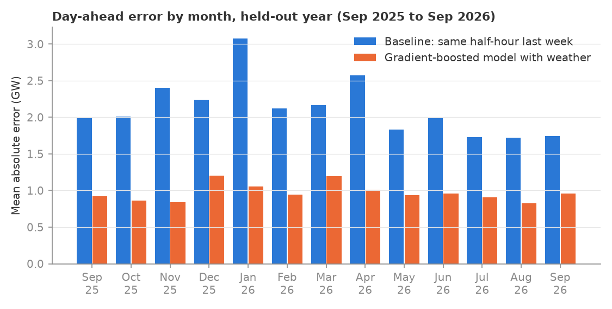
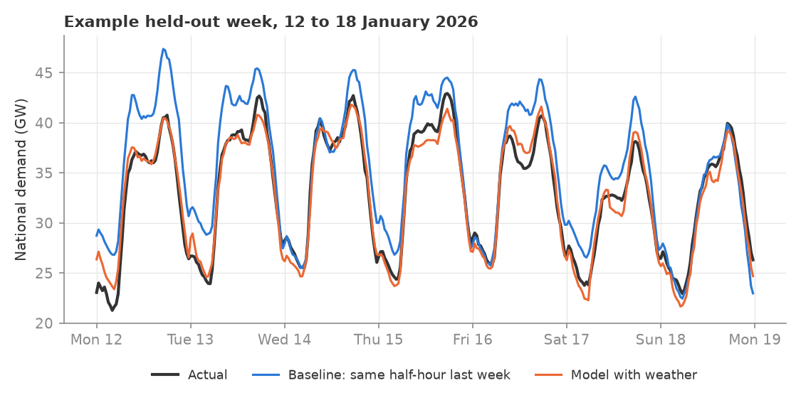
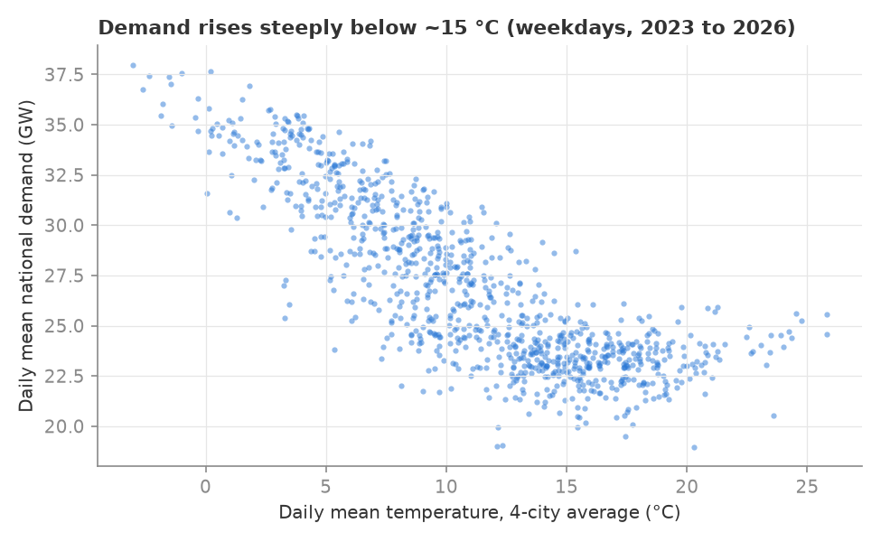
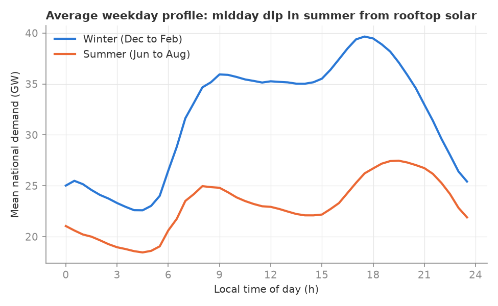
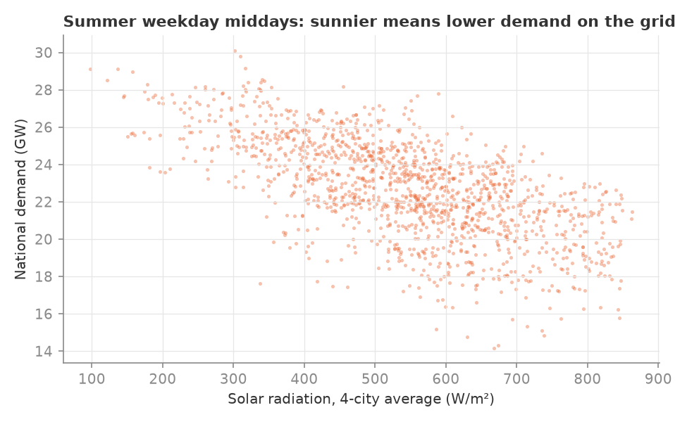
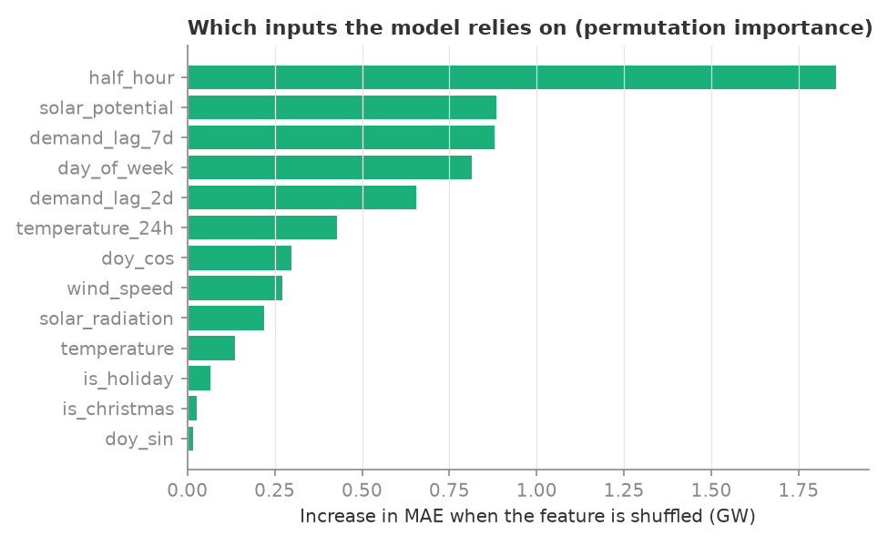

# GB day-ahead electricity demand forecast

A day-ahead forecast of half-hourly national electricity demand in Great Britain, built from public data: NESO demand records and ERA5 reanalysis weather from Open-Meteo.

On a held-out year (19 September 2025 to 18 September 2026), a gradient-boosted tree model with calendar, lagged-demand and weather features reduces the mean absolute error by **54%** compared with a simple "same half-hour last week" baseline (**0.98 GW vs 2.14 GW**, MAPE **3.9% vs 8.4%**). This uses observed rather than forecast weather, so it is an upper bound on real-world skill (see [Limitations](#limitations)).

## Results

| Model | MAE (MW) | RMSE (MW) | MAPE | MAE vs baseline |
|---|---:|---:|---:|---:|
| Baseline: same half-hour last week | 2,141 | 2,893 | 8.4% | |
| Gradient-boosted model, calendar and lags only | 1,564 | 2,080 | 6.3% | -27% |
| Gradient-boosted model, with weather | **975** | **1,283** | **3.9%** | **-54%** |

The comparison without weather separates the two sources of improvement: a better use of calendar and recent demand accounts for about half of the gain, and weather for the rest.

The model improves on the baseline in every month of the test year. Errors are higher on bank holidays and over Christmas (1.66 GW vs 0.95 GW on normal days), where there is little training data.





## What the data shows

Exploration before modelling pointed to three effects the model needs to capture:

- **Temperature.** Daily demand rises steeply below about 15 °C (heating) and is fairly flat above it (correlation -0.82 on weekdays).
- **Time of day and season.** Winter weekdays peak at around 40 GW in the early evening; summer demand is lower and flatter.
- **Rooftop solar.** National demand is measured on the transmission network, so solar panels on homes and businesses show up as *reduced* demand. On summer weekday middays, sunnier weather means visibly lower demand (correlation -0.64).

| | | |
|---|---|---|
|  |  |  |

## Method

**Forecast setting.** A forecast for every half-hour of day D is assumed to be issued around midday on D-1. The most recent demand that is known for *every* target half-hour at that point is from two days earlier, so lagged demand is restricted to 2 and 7 days before the target. This keeps the evaluation honest about what would actually be available.

**Features.**
- Calendar: half-hour of the (local) day, day of week, England and Wales bank holidays, Christmas period, and day of year (as sine and cosine).
- Lagged demand: same half-hour 2 days and 7 days earlier.
- Weather, averaged over London, Birmingham, Manchester and Glasgow: temperature, 24-hour mean temperature (buildings respond to sustained cold, not single readings), solar radiation and wind speed.
- Solar potential: solar radiation multiplied by NESO's estimate of installed embedded solar capacity, since rooftop output grows as more panels are installed.

**Model.** scikit-learn `HistGradientBoostingRegressor` with absolute-error loss. The number of boosting rounds is chosen on the last three months of the training period, then the model is refitted.

**Split.** Training data runs from January 2023 to 18 September 2025; the final 12 months are held out and used only once for evaluation. No information from the test year is used for training or tuning.

**Feature importance.** Permutation importance on the test year shows the model relies most on time of day, then on solar potential, the weekly demand lag and day of week. Temperature mainly enters through the 24-hour mean.



## Limitations

- **Observed instead of forecast weather.** The model uses reanalysis weather for the target day, which a real day-ahead forecast would not have. Real weather forecasts carry errors, so operational accuracy would be lower. The next step is to retrain and evaluate on archived weather forecasts (Open-Meteo provides historical forecast data).
- **Lags across clock changes.** The demand lags are fixed shifts in UTC, so for a week after each clock change, "the same half-hour last week" is an hour off in local clock time. On the test year, the baseline is about 16% worse in those weeks, while the model is barely affected (about 1%), because it can rely on the local time-of-day feature instead. Computing lags in local time would remove the effect.
- **Simple weather proxy.** An unweighted average of four cities is a rough stand-in for GB-wide conditions. Population- or demand-weighted averages over more locations would likely help, especially for solar.
- **Weak baseline only.** The baseline is deliberately naive. A fairer benchmark would be NESO's own published day-ahead demand forecast, which I have not compared against yet.
- **Point forecasts only.** Trading decisions need uncertainty as well as a central estimate. Quantile loss would give prediction intervals with little extra work.
- **One held-out year, little tuning.** The results come from a single train/test split and lightly chosen hyperparameters.

## Running it

```bash
pip install -r requirements.txt
python src/explore.py    # exploratory plots
python src/forecast.py   # trains models, prints metrics, writes results/
```

The data files are not included in the repository. Download them into `data/`:

1. **Demand:** yearly CSVs from the [NESO Historic Demand Data](https://www.neso.energy/data-portal/historic-demand-data) page (2023 to 2026).
2. **Weather:** one CSV from the Open-Meteo historical weather API:
   `https://archive-api.open-meteo.com/v1/archive?latitude=51.51,52.48,53.48,55.86&longitude=-0.13,-1.90,-2.24,-4.25&start_date=2023-01-01&end_date=2026-09-30&hourly=temperature_2m,shortwave_radiation,wind_speed_10m&timezone=UTC&format=csv`

## Data notes

- NESO settlement periods count half-hours from local UK midnight, so clock-change days have 46 or 50 periods. All data is converted to UTC.
- The yearly NESO files use three different date formats; the current-year file also includes forecast rows, which are dropped.

## Data sources

- Demand: National Energy System Operator (NESO), Historic Demand Data, under the NESO Open Data Licence.
- Weather: [Open-Meteo](https://open-meteo.com/) historical weather API (ERA5 reanalysis, Copernicus Climate Change Service), CC BY 4.0.
